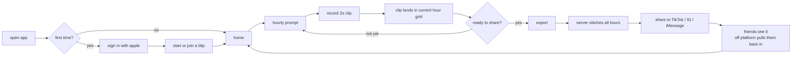
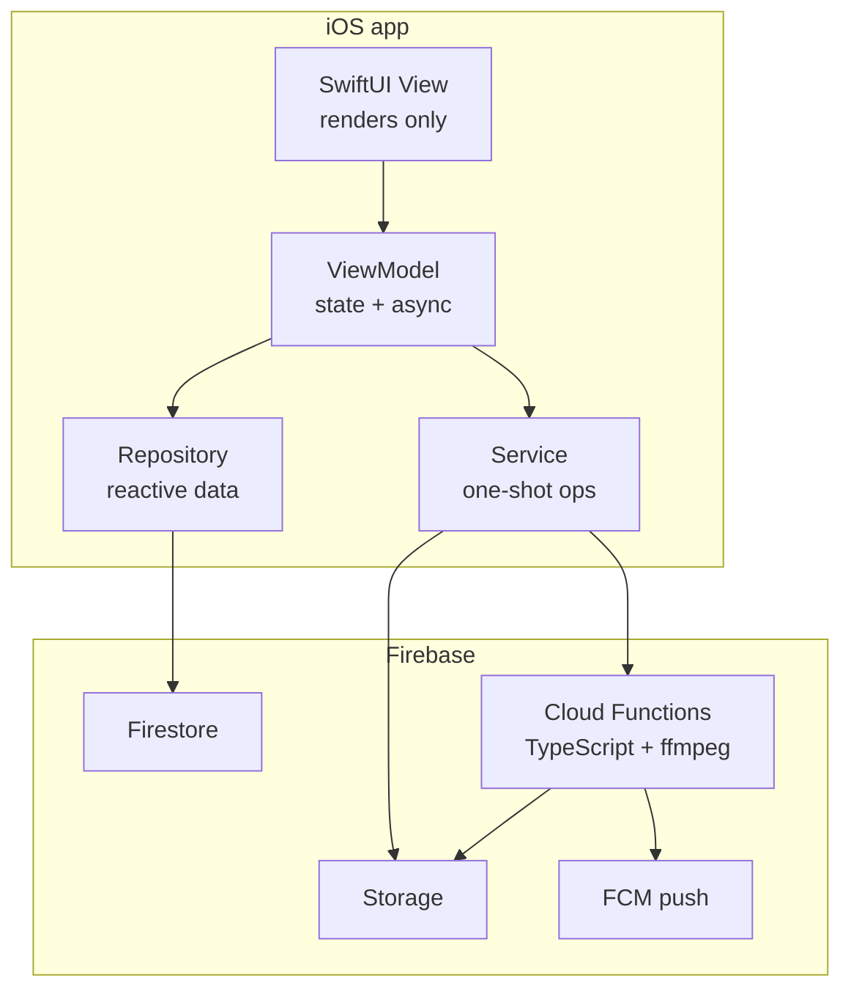

# Welcome to Blip

You just joined. This doc is the shortest version of "what we're building, why, and how" — designed so you're useful by the end of week one.

If you only read one section: **The mechanic** below is the whole product.

---

## 1. What is Blip?

Blip is an iOS app for friend groups. Every hour, each person in the group posts a **2-second** video clip of what they're doing. At any time, anyone can hit **export** — and the whole day stitches together into a single short video the group can save and share.

That's it. The whole product.

It's not a feed. It's not a story. It's not a chat-first app. It's a **shared time capsule** that gets built passively over the day and explodes outward (TikTok, Instagram, iMessage) the second someone hits export.

---

## 2. The mechanic, in plain English

1. You start a **blipchat** — a group of 3–6 friends.
2. Once an hour, each member is prompted to record a 2-second clip.
3. The hour's clips are arranged in a grid (1×1 for solo, 2×1 for pairs, 2×2 for 3–4, growing wider for bigger groups).
4. Hours where **nobody posts** are skipped — they don't appear in the export at all. This is important: dead time is invisible.
5. Anyone can **export** at any moment. The server stitches every contributed hour into one video. That video is the artifact. That video is the point.

The cadence is hourly. The clip length is two seconds. Both are non-negotiable for the v1 product feel.

### The user journey, end to end



The loop on the right side — **share → friends see → friends sign up → join the blipchat → record their own clip** — is the growth engine. The hourly prompt on the left is what keeps the loop fed.

---

## 3. Who it's for

Gen Z friend groups in the US — high school and college, groups of 3–6. They:

- Already share day-in-the-life content on TikTok and Instagram.
- Already have group chats with their close friends.
- Get bored of feed-style apps fast.
- Will quit anything that feels like work.

Two-second clips and an hourly pulse keep the effort low. The export is the reward.

---

## 4. The viral spine (read this twice)

Most of what we do points at **one moment**: someone hits export, gets back a stitched video, and posts it off-platform.

If the stitched video isn't good enough to post on TikTok, nothing else matters. Every design and engineering decision should be evaluated against:

> "Does this make the export better, more shareable, or more frequent?"

If the answer is "no," the work is probably lower priority than it feels.

---

## 5. Brand & voice — "Lane A"

Blip's voice is:

- **Group-first.** Always plural. "Who's in your day?" not "Who's in your day?"
- **Calm, observational, modern.** Sentence case everywhere. No exclamation points.
- **Confident.** Short sentences. No hedging.
- **Warm but not cute.** No emoji in product copy. No mascot. No doodles.

Examples that pass:
- "you're the last one. tap to make it count."
- "two seconds an hour. that's the whole app."
- "no pings while you sleep."

Examples that fail:
- "Hey friend! 👋 Don't miss your hourly Blip!" (overcheerful, capitalized, emoji)
- "Capture this beautiful moment with your tribe ✨" (corporate, generic)

When in doubt, default to under-writing. Trust the user.

---

## 6. Design system

Everything visual ties back to a small set of tokens. Don't introduce ad-hoc colors, font sizes, or radii.

**Colors** (resolve light/dark automatically):
- `background`, `surface`, `surfaceElevated` — three depth levels
- `textPrimary`, `textSecondary`, `textTertiary` — type hierarchy
- `accent` — warm amber `#E8A87C`, used for live/recording/active states only
- `accentNeutral` — the primary CTA fill (white in dark mode, near-black in light)
- `error` — warm rose

**Typography:** Geist, bundled. The wordmark `Geist-Black 38pt` is reserved for the export's end card and onboarding only — never in-app chrome.

**Components live in `DesignSystem/`.** Before building a new button, field, card, or row — check there first. The standard set covers ~90% of cases:
`BlipButton`, `BlipCard`, `BlipTextField`, `AvatarView`, `ErrorText`, `BlipStatTile`, `BlipLinkRow`, `ClipTimestampLabel`.

**Layout rules:**
- Tap targets ≥ 44×44.
- Icon-only buttons need an `accessibilityLabel`.
- No hardcoded heights inside reusable components — they break in grids.
- Adaptive grids only — never hardcode column counts.

---

## 7. Code structure

```
Features/<Feature>/
  <Feature>View.swift       — SwiftUI view, no business logic
  <Feature>ViewModel.swift  — @MainActor ObservableObject, owns state + async
Services/
  <Name>Repository.swift    — reactive data (Firestore listeners)
  <Name>Service.swift       — one-shot operations (auth, upload, etc.)
DesignSystem/
  Blip<Component>.swift     — reusable UI atoms
```

New features always get their own folder under `Features/`. Don't add feature-specific code to an existing feature's folder.

### How the layers talk to each other



Rules of the road:
- Views never call Firestore, Storage, or Auth directly. Ever.
- ViewModels receive dependencies as protocols, not concrete types.
- The stitch happens in a Cloud Function. The client only kicks it off and downloads the result.

**Stack:**
- iOS native, Swift, SwiftUI, iOS 17+
- Firebase (Auth, Firestore, Storage, Functions, FCM)
- Cloud Functions in TypeScript
- Stitching is **server-side only** (`ffmpeg` in a Cloud Function). On-device stitching exists only for preview iteration.
- XcodeGen — `project.yml` is canonical. Always close Xcode before running `xcodegen generate` to avoid duplicate Compile Sources entries.

---

## 8. SOLID — enforced, not aspirational

Every Swift file is reviewed against these. Violations block merge.

- **S — Single Responsibility:** A view renders. A view model holds state. A repository owns data. A service owns one external concern. If a file imports both `SwiftUI` and `FirebaseFirestore`, it's almost certainly wrong.
- **O — Open/Closed:** Add behavior by adding new types, not by editing existing ones. Use exhaustive `switch` over enums.
- **L — Liskov:** Mocks must be honest substitutes. No `fatalError` in protocol stubs.
- **I — Interface Segregation:** Small focused protocols. Thin write-only protocols (e.g. `BlipMutating`) for view models that don't observe.
- **D — Dependency Inversion:** View models receive dependencies via initializer params, typed as protocols. They never instantiate `BlipRepository`, `Firestore`, `Storage`, etc. directly.

---

## 9. App Store posture

Blip is a UGC/social app, which Apple reviews strictly. We build moderation in from day one — retrofitting after rejection costs weeks.

**Required surfaces:**
- Report button on every clip
- Block button on every user
- In-app account deletion
- Reactive moderation (human review after reports) is sufficient for v1
- Privacy manifest declaring data collected + sensitive APIs used
- Contextual permission prompts only (camera/mic when the user taps to record — never on launch)

**Launch geography:** US only. Australia's under-16 social ban (effective 2025-12-10) needs real age verification, which we don't have. EU defers post-MVP.

**Age rating:** plan for 17+ unless moderation is airtight.

---

## 10. Privacy & quiet hours

The cadence is hourly, but every notification path respects the recipient's quiet window. Nudges never wake people up. The product is intentionally less aggressive than its category — that restraint is part of the brand.

Day boundary is **4 AM in the blip's timezone** (not per-user), set when the blip is created and defaulting to the creator's TZ. This keeps the stitched export coherent — a single calendar day produces one cut.

---

## 11. Where things live

| What | Where |
|------|-------|
| Project repo | `/Users/edisonlee/blip/` (or your local clone) |
| Design system tokens | `blip/DesignSystem/BlipColor.swift`, `BlipTypography.swift` |
| Reusable UI atoms | `blip/DesignSystem/` |
| Cloud Functions | `functions/` (TypeScript) |
| Design file (.pen) | `Designs/blip.pen` — open with the Pencil app |
| Lane A copy reference | `.claude/agents/copy-writer.md` |
| Project conventions (this dense version) | `CLAUDE.md` |

---

## 12. First-week checklist

**Day 1**
- Read this doc end-to-end.
- Skim `CLAUDE.md` for the dense engineering conventions.
- Open `Designs/blip.pen` in the Pencil app and walk through every screen.
- Pull the repo, run `xcodegen generate`, build the app on a simulator.

**Day 2–3**
- Create a real blip with another team member. Record clips for a full day.
- Hit export. Watch the stitched video. **Try posting it to TikTok.** Note every place the polish breaks.

**Day 4–5**
- Pick up a small task from the issue tracker.
- Read the file you're touching plus the file directly above it in the dependency graph.
- Open a draft PR early. Get a SOLID + Lane A review before polishing.

**End of week 1**
- You should be able to explain the mechanic to a friend in under 60 seconds without using the words "story" or "feed."
- You should know which folder a new feature belongs in without asking.
- You should have shipped at least one merged PR.

---

## 13. Shorthand glossary

- **blip** — a blipchat (the group), or sometimes the stitched export. Context disambiguates.
- **blipchat** — the group chat / shared time capsule
- **blip clip** — a single 2-second video posted by one member in one hour
- **stitch** — server-side concatenation of all hours' grids into one MP4
- **export** — the user-initiated action that triggers a stitch and surfaces the share sheet
- **hour** — the bucket clips live in. Posting again in the same hour replaces the previous clip until the hour rolls over.
- **nudge** — a one-tap push that pings a specific group member who hasn't posted yet
- **last one** — the highest-conversion notification: fires when N-1 of N members have posted

---

If something in this doc contradicts what you see in the code, the code is probably stale and you should fix the doc. Open a PR.

Welcome.
